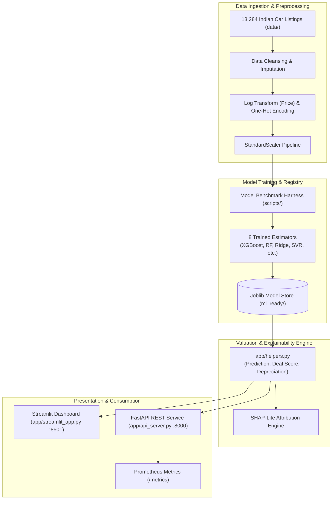

# Price-My-Car (AutoIntel v6.0)

[](https://github.com/themanoj-025/Price-My-Car/actions)
[](./LICENSE)
[](https://www.python.org/)
[](https://fastapi.tiangolo.com/)
[](https://streamlit.io/)
[](tests/)

Production-ready machine learning intelligence platform for estimating used car
valuations in the Indian automotive market. Powered by 13,284 listings, an ensemble
of 8 regression estimators, a 9-page interactive Streamlit terminal, Deal Score
gauges, depreciation curve analysis, and a production FastAPI service.

---

## Quick Facts

| Dimension | Details |
| --- | --- |
| **Domain** | Automotive Intelligence, Price Valuation & Depreciation Modeling |
| **Dataset Scale** | 13,284 verified Indian used car listings across major metropolitan markets |
| **ML Algorithms** | 8 models (Linear, Ridge, Lasso, KNN, SVR, RandomForest, GradientBoosting, XGBoost) |
| **Explainability** | SHAP-Lite linear and tree feature attribution waterfall plots |
| **Specialized Metrics** | Deal Score (0–100 gauge), multi-year depreciation curves, and INR currency formatting |
| **Interfaces** | 9-page Streamlit portal + FastAPI async REST microservice |
| **Test Coverage** | 285 collected tests across 13 unit and integration suites |
| **License** | [MIT License](./LICENSE) |

---

## Table of Contents

- [What It Does](#what-it-does)
- [Model Benchmark](#model-benchmark)
- [Screenshots](#screenshots)
- [Key Features](#key-features)
- [Architecture](#architecture)
- [Tech Stack](#tech-stack)
- [Prerequisites](#prerequisites)
- [Quick Start](#quick-start)
- [Configuration](#configuration)
- [Project Structure](#project-structure)
- [API Reference](#api-reference)
- [Testing](#testing)
- [Limitations](#limitations)
- [Contributing](#contributing)
- [Security](#security)
- [License](#license)

---

## What It Does

Used car valuations across India are notoriously non-transparent. Pricing fluctuates
erratically based on local brand reputation, transmission type, fuel economy,
mileage thresholds, and geographic registration. Buyers frequently overpay, while
sellers leave capital on the table.

**AutoIntel (Price-My-Car)** delivers an end-to-end pricing intelligence platform:
1. **Multi-Model Valuation Ensemble:** Trains and evaluates 8 distinct regression
   algorithms to establish robust price predictions with calibrated confidence bounds.
2. **Deal Score Rating:** Computes an objective 0–100 fairness score comparing
   a listed vehicle price against statistical market equilibrium.
3. **Depreciation Projections:** Estimates future resale trajectories over 1, 3,
   and 5 years to forecast total cost of ownership.
4. **SHAP-Lite Explainability:** Highlights the top positive and negative value
   drivers (e.g. low mileage premium, older model year penalty).
5. **Dual Serving Architecture:** Provides a multi-page analytical dashboard
   for consumer exploration alongside an authenticated FastAPI REST endpoint.

---

## Model Benchmark

The training pipeline preprocesses categorical attributes via one-hot encoding,
applies log transforms to skewed price distributions, and evaluates 8 estimators:

| Model Family | Algorithm Type | Key Strength | Role in Platform |
| --- | --- | --- | --- |
| **Gradient Boosting** | Ensembled Trees | Captures complex non-linear feature splits | Top-tier ensemble member |
| **XGBoost** | Gradient Boosted Trees | High-velocity prediction on tabular inputs | Primary high-confidence estimator |
| **Random Forest** | Bagged Decision Trees | Resilient against outlier listings and noise | Generalization baseline |
| **Support Vector Regressor** | Kernel SVR | Robust margin fitting in feature space | Non-linear comparative baseline |
| **Ridge Regression** | L2 Regularized Linear | Fast linear baseline preventing collinearity | SHAP-Lite linear explainer |
| **Lasso Regression** | L1 Regularized Linear | Automated feature sparsity and pruning | Regularization check |
| **K-Nearest Neighbors** | Instance-Based | Direct neighbor price indexing | Local market comparator |
| **Linear Regression** | Ordinary Least Squares | Transparent baseline coefficients | Unregularized benchmark |

---

## Screenshots

<!-- TODO[L2-01]: Add car price prediction and Deal Score gauge screenshots from running Streamlit instance -->
> *Interactive price prediction form, Deal Score fairness gauge, and 5-year depreciation trajectory curves.*

---

## Key Features

- **9 Dashboard Modules:** Dedicated interfaces for market overview, dataset
  exploration, exploratory data analysis, multi-model evaluation lab, residual
  diagnostics, interactive pricing, market intelligence, pipeline inspection, and administration.
- **Deal Score Gauge (0–100):** Visual speedometer gauge indicating whether a
  quoted listing represents a "Steal", "Fair Price", or "Overpriced" listing.
- **SHAP-Lite Attributions:** Instant feature importance cards displaying exactly
  which specifications increased or discounted the final valuation.
- **Full Offline Portability:** Operates locally with zero mandatory external API keys
  and persists user profiles locally via encrypted bcrypt hashes.
- **Enterprise REST Gateway:** Async FastAPI microservice with SlowAPI rate limiting,
  Prometheus telemetry counters, structured JSON logging, and optional API key protection.

---

## Architecture



### Core Modules

- **`app/helpers.py`**: Business logic hub providing model loading, single and
  batch predictions, Deal Score calculation, and Indian Rupee (`fmt_inr`) formatting.
- **`app/api_server.py`**: Production HTTP server exposing `/api/v1/predict`,
  `/api/v1/stats`, `/api/v1/brands`, and `/api/v1/fuel-types`.
- **`app/auth_db.py`**: Authentication subsystem handling user registration,
  bcrypt password verification, and admin role assignments.

---

## Tech Stack

| Layer | Component | Version | Purpose |
| --- | --- | --- | --- |
| **Language** | Python | `>=3.12` | Modern typed runtime |
| **Dashboard UI** | Streamlit | `1.57.x` | 9-page interactive discovery portal |
| **API Framework** | FastAPI & Uvicorn | `>=0.143.0` | Production async REST API |
| **Tabular ML** | scikit-learn & XGBoost | Latest | Regression modeling and preprocessing |
| **Visualizations** | Plotly & Matplotlib | Latest | Depreciation graphs, residual plots, gauges |
| **Data Engine** | Pandas & NumPy | Latest | Vector operations and tabular manipulation |
| **Security** | bcrypt | Latest | Cryptographic password hashing |
| **Rate Limiter** | SlowAPI | Latest | IP-based request throttling |
| **Metrics** | Prometheus Client | Latest | Latency and throughput observation |

---

## Prerequisites

- **Python 3.12+**
- **uv** (recommended) or standard `pip`
- Optional: **Docker** for containerized execution

---

## Quick Start

### 1. Clone & Set Up Virtual Environment

```bash
git clone https://github.com/themanoj-025/Price-My-Car.git
cd Price-My-Car
```

#### Windows (PowerShell)

```powershell
python -m venv .venv
.venv\Scripts\Activate.ps1
pip install -r requirements.lock
Copy-Item .env.example .env
```

#### Linux / macOS

```bash
python3 -m venv .venv
source .venv/bin/activate
pip install -r requirements.lock
cp .env.example .env
```

### 2. Launch the Streamlit Analytical Portal

```bash
streamlit run app/streamlit_app.py
```

The 9-page dashboard will launch in your browser at [http://localhost:8501](http://localhost:8501).

### 3. Launch the FastAPI Prediction Server

In a separate terminal:

```bash
uvicorn app.api_server:app --host 0.0.0.0 --port 8000 --reload
```

*Expected output:*
```text
{"timestamp": "...", "level": "INFO", "message": "AutoIntel ML models and artifacts loaded"}
{"timestamp": "...", "level": "INFO", "message": "FastAPI server running on http://0.0.0.0:8000"}
```

Explore OpenAPI documentation at [http://localhost:8000/docs](http://localhost:8000/docs).

---

## Configuration

Configuration parameters can be configured in `.env` or passed via environment variables:

| Variable | Default | Secret? | Description |
| --- | --- | --- | --- |
| `PRICE_MY_CAR_API_KEY` | `""` | Yes | Optional Bearer key to secure `/api/v1/predict` endpoint |
| `API_HOST` | `0.0.0.0` | No | Host binding for FastAPI server |
| `API_PORT` | `8000` | No | Port binding for FastAPI server |

---

## Project Structure

```text
Price-My-Car/
├── app/                        # Application core
│   ├── api_server.py           # FastAPI prediction and stats microservice
│   ├── auth_db.py              # User authentication and bcrypt state
│   ├── chart_utils.py          # Plotly gauge and depreciation plot generators
│   ├── circuit_breaker.py      # Circuit breaker fault isolation
│   ├── health.py               # Liveness and model readiness probes
│   ├── helpers.py              # Prediction math, Deal Score, INR formatting
│   ├── pages/                  # 9 Streamlit multipage view modules
│   └── streamlit_app.py        # Streamlit main dashboard landing
├── data/                       # Raw and processed Indian car listings
├── ml_ready/                   # Exported preprocessors and model binaries
├── notebooks/                  # Model training and exploration notebooks
├── tests/                      # Pytest suite (285 unit and integration tests)
├── .env.example                # Sample environment template
├── docker-compose.yml          # Container configuration
├── Dockerfile                  # Multi-stage production container build
├── pyproject.toml              # Build specifications and lint rules
└── README.md
```

---

## API Reference

| Method | Endpoint | Auth | Description |
| --- | --- | --- | --- |
| `GET` | `/health` | Public | Liveness probe verifying model availability |
| `GET` | `/metrics` | Public | Prometheus scraping endpoint for latencies and request counters |
| `GET` | `/api/v1/stats` | Public | Total dataset listings, brand counts, and average prices |
| `GET` | `/api/v1/brands` | Public | Alphabetical list of available manufacturer brands |
| `GET` | `/api/v1/fuel-types` | Public | List of recognized fuel categories (Petrol, Diesel, CNG, etc.) |
| `POST` | `/api/v1/predict` | Optional | Estimate vehicle price with Deal Score and feature weights |

### Sample Prediction Request

```bash
curl -X POST "http://localhost:8000/api/v1/predict" \
     -H "Content-Type: application/json" \
     -d '{
       "brand": "Maruti",
       "year": 2019,
       "km_driven": 45000,
       "fuel": "Petrol",
       "transmission": "Manual",
       "owner": "First Owner"
     }'
```

---

## Testing

The test suite covers data preprocessing, log inversions, deal score calculations,
depreciation curves, API endpoints, rate limits, and structured JSON logs.

```bash
# Run all tests
pytest tests/ -v -o addopts=""

# Run with test coverage
pytest tests/ --cov=app -o addopts=""
```

All test suites execute self-contained against committed model artifacts with
no external network requirements.

---

## Limitations

- **Regional Market Scope:** The underlying dataset is trained specifically on
  Indian used car listings; pricing dynamics do not translate directly to European or US markets.
- **RTO Tax Variance:** State-level road tax differentials and individual vehicle
  cosmetic condition are not captured in tabular mileage/year inputs.
- **Trim-Level Granularity:** High-level model names are used; rare sub-trim packages
  may exhibit variance around standard confidence intervals.

---

## Contributing

Contributions are welcome! Please follow these guidelines:

1. Fork the repository.
2. Create your topic branch: `git checkout -b feat/my-improvement`.
3. Verify linting and formatting: `ruff check .` and `black .`.
4. Ensure all tests pass: `pytest tests/ -o addopts=""`.
5. Open a pull request against `main`.

See [CONTRIBUTING.md](./CONTRIBUTING.md) for full instructions.

---

## Security

Please report vulnerabilities privately via GitHub Security Advisories or by
contacting the repository maintainers. Never commit sensitive keys or personal data.
See [SECURITY.md](./SECURITY.md) for full policy.

---

## License

This project is licensed under the [MIT License](./LICENSE).
